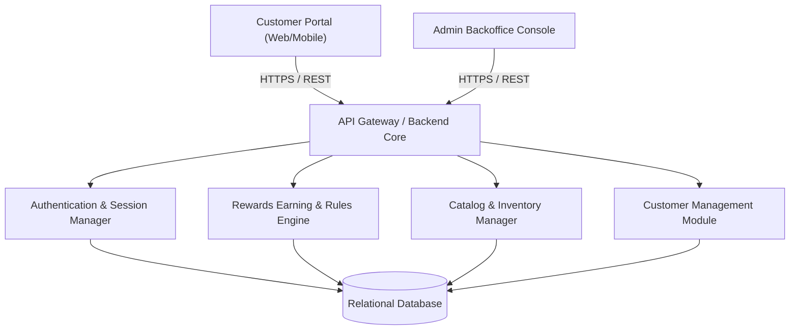
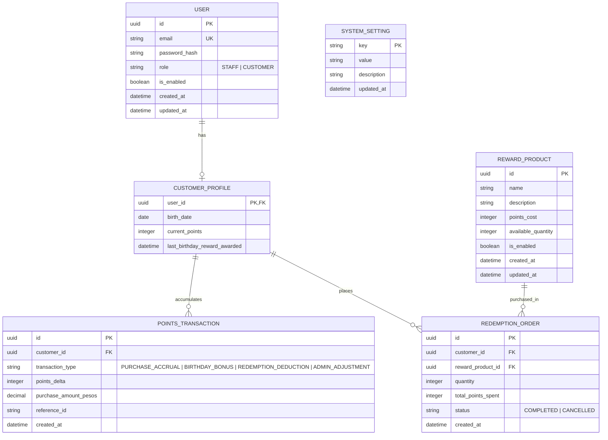

# System Architecture Overview

## 1. High-Level Architecture

The Rewards Application is designed as a decoupled modern web application with a client presentation layer (Customer Portal & Admin Backoffice) communicating over HTTPS with a secure backend API.



---

## 2. Domain Data Model & Entity Relationships



---

## 3. Authentication & Token Lifecycle Architecture

The authentication subsystem enforces a layered token and session expiration strategy as specified in the business requirements:

| Token / Session Construct | Configured Threshold | Behavior & Expiration Rules |
| --- | --- | --- |
| **Session Lifetime** | 6 Hours | Maximum continuous active user session window. |
| **Access Token Absolute Expiry** | 1 Day (24h) | The lifespan after which the access token must be refreshed. |
| **Access Token Idle Expiry** | 2 Days (48h) | Token invalidation ceiling if no API calls occur. |
| **Refresh Token Idle Expiry** | 7 Days | Token is revoked and invalidated if inactive for 7 consecutive days. |
| **Refresh Token Absolute Expiry** | 30 Days | Absolute maximum lifetime; requires full re-authentication with email and password upon reaching 30 days. |

### Token Refresh Flow
```mermaid
sequenceDiagram
    autonumber
    actor User as Client Application
    participant API as API Gateway / Auth Server
    participant DB as Auth Store / Redis

    User->>API: POST /api/v1/auth/login (email, password)
    API->>DB: Validate credentials & enabled status
    DB-->>API: Validated (Role: CUSTOMER or STAFF)
    API-->>User: Returns Access Token (1d expiry) & Refresh Token (30d max, 7d idle)

    Note over User, API: Routine API Usage (Access Token attached in Bearer header)
    User->>API: GET /api/v1/rewards (Bearer Access Token)
    API-->>User: 200 OK (Catalog response)

    Note over User, API: Access Token expires (after 1 day)
    User->>API: POST /api/v1/auth/refresh (Refresh Token)
    API->>DB: Check if Refresh Token is < 30 days old and idle < 7 days
    alt Valid Refresh Token
        API->>DB: Update last_activity_timestamp
        API-->>User: Returns new Access Token (1d) & rolled Refresh Token
    else Expired or Idle Exceeded
        API-->>User: 401 Unauthorized (Session expired; please login again)
    end
```

---

## 4. Key Architectural Patterns & Constraints
1. **ACID Transaction for Redemption**:
   * Point balance deduction and reward product inventory decrement must execute within a single atomic database transaction using pessimistic/row-level locking (`SELECT ... FOR UPDATE`) to prevent double-spending or overselling.
2. **Configurable Ratio Storage**:
   * The `cost_to_points_ratio` is stored in `SYSTEM_SETTING` and loaded with an in-memory cached read pattern, invalidating whenever Staff updates the ratio.
3. **Auditing & Traceability**:
   * Every point change is recorded in an immutable ledger (`POINTS_TRANSACTION`), enabling accurate calculation of total orders, points accruals, and remaining points balance.
