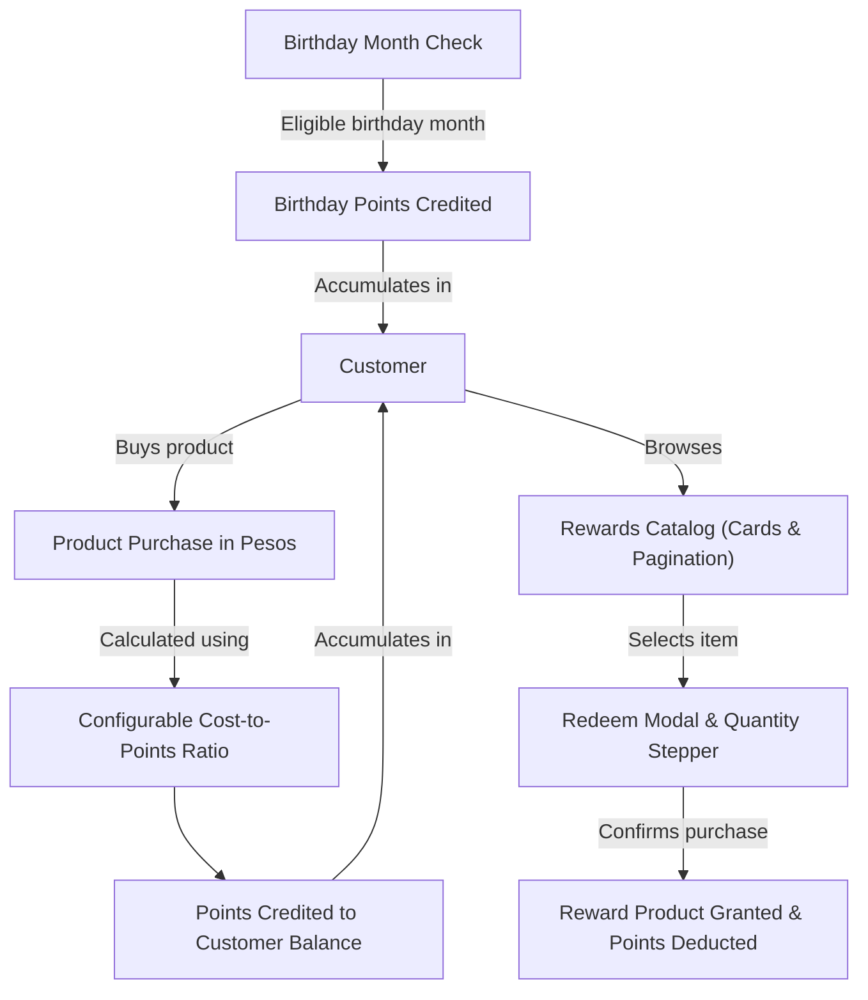

# Business Overview

## 1. Problem Statement & Objective
Modern e-commerce requires customer engagement strategies that drive repeat purchases and increase Customer Lifetime Value (CLV). The **Rewards Application** provides a customer loyalty and rewards engine where:
1. Customers are rewarded with points upon making qualifying purchases.
2. An additional incentive is awarded during the customer's birthday month.
3. Accumulated points serve as an internal currency that customers spend on exclusive reward products in the rewards catalog.
4. Administrative staff maintain centralized control over inventory, customer statuses, and reward valuation ratios.

---

## 2. User Personas & Roles

### 2.1 Customer
* **Role**: Primary end-user purchasing goods and utilizing earned reward points.
* **Key Goals**:
  * Authenticate securely using email and password.
  * Earn reward points automatically when completing purchases based on the active cost-to-points ratio.
  * Receive birthday reward points during their birthday month.
  * Browse available reward products in an intuitive card layout with pagination.
  * Inspect product details and redeem points for products via an interactive modal with a quantity stepper.
  * Track remaining points balance and past redemption orders.

### 2.2 Staff (Admin)
* **Role**: Operational and administrative user managing loyalty operations.
* **Key Goals**:
  * Access secure back-office admin capabilities.
  * Monitor registered customers, active balances, and order histories.
  * Deactivate (disable) or reactivate (enable) customer accounts as needed.
  * Configure system-wide points earning mechanics (cost-to-points ratio per Philippine Peso / currency unit).
  * Manage the reward product catalog: create items, adjust stock counts, toggle customer visibility, and remove discontinued products.

---

## 3. Core Business Mechanics

### 3.1 Points Conversion Mechanism
* Points are calculated as a function of the purchase amount in Philippine Pesos (PHP).
* The ratio is managed by the system administrator (e.g., $X$ PHP spent $= 1$ Reward Point).
* Points are integers or rounded based on configured system rules (default floor or exact fractional handling to be established).

### 3.2 Birthday Incentive
* Automatically grants bonus points to registered customers during their registered birthday month.

### 3.3 Rewards Redemption
* Reward products have fixed point costs and finite stock.
* Purchases deduct points instantaneously from the customer balance and reduce product stock.

---

## 4. Key Success Metrics (KPIs)
* **Repeat Purchase Rate (RPR)**: Increase in returning purchase frequency driven by point accrual.
* **Reward Redemption Rate (RRR)**: Ratio of earned points redeemed for rewards versus expired/idle points.
* **Catalog Engagement**: Time spent and interaction rate across the reward product catalog.
* **Admin Efficiency**: Real-time control and zero downtime for updating conversion ratios and product stocks.
