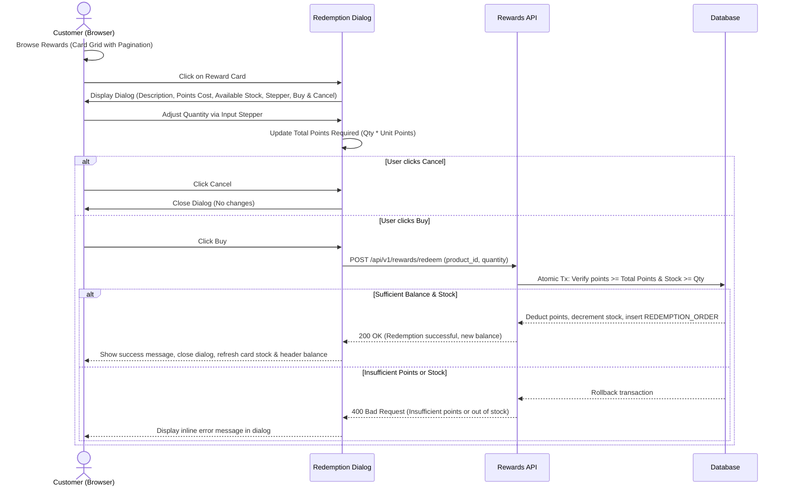

# Feature Specification: FEAT-003 Customer Rewards Catalog & Redemption

## 1. Metadata
* **Feature ID**: `FEAT-003`
* **Title**: Customer Rewards Catalog & Redemption Modal
* **Status**: In Review / Specified
* **Owner**: Frontend & Core Product Team
* **Source Link**: [Confluence - Features (Page ID: 163976)](https://joycekrystallagudas.atlassian.net/wiki/spaces/~5add6ce37b296356232d7884/pages/163976/Features)
* **Last Verified Date**: 2026-10-31

---

## 2. Business Outcome & Success Measure
Provides customers with a clear, engaging visual catalog of available rewards with seamless point redemption through an interactive dialog with quantity selection, ensuring transparent points deduction and instant gratification.

---

## 3. Users & Target Personas
* **Customer**: Browses reward options, checks their points feasibility, selects desired quantities, and redeems products.

---

## 4. Scope
* **In-Scope**:
  * Customer-facing catalog page displaying rewards in a responsive card grid with pagination.
  * Each card displays: Product Name, Description, Points Cost, and Available Quantity.
  * Only products marked as `is_enabled = true` and `available_quantity > 0` are displayed to customers.
  * Clicking a card opens a modal dialog containing:
    * Full reward description.
    * Input stepper control to select desired quantity.
    * Real-time total points calculation ($quantity \times points\_cost$).
    * "Buy" button (initiates redemption).
    * "Cancel" button (closes modal without changes).
  * Backend redemption transaction: atomicity, customer points balance deduction, stock decrement, and order creation.
* **Out-of-Scope**:
  * Physical shipping address tracking / delivery carrier integration (can be added as logistics enhancement).
  * Wishlist or pre-order reservations.

---

## 5. UI & Interaction Flow



---

## 6. Numbered Acceptance Criteria

* **AC-FEAT-003-01 (Card Layout & Information)**: Given a customer viewing the Rewards page, the rewards must be presented in a card layout where each card clearly shows:
  * Reward name.
  * Reward description.
  * Points cost to purchase.
  * Number of products available (remaining stock).
* **AC-FEAT-003-02 (Catalog Pagination)**: Given more reward items than the page limit, the system must provide pagination controls (next, previous, page numbers) to navigate through items cleanly.
* **AC-FEAT-003-03 (Modal Trigger & Contents)**: Given a customer clicks on any reward card, the system must open a popup modal containing:
  * Full product description.
  * Input stepper to increment/decrement selected quantity.
  * "Buy" button.
  * "Cancel" button.
* **AC-FEAT-003-04 (Input Stepper Constraints)**: Given the input stepper in the redemption modal:
  * Default quantity is 1.
  * Minimum quantity is 1 (decrement button disabled at 1).
  * Maximum quantity cannot exceed available product quantity or maximum units affordable with the customer's balance.
* **AC-FEAT-003-05 (Cancel Action)**: Given the open redemption dialog, when the user clicks the "Cancel" button, the modal closes immediately and no points or inventory are modified.
* **AC-FEAT-003-06 (Successful Redemption Execution)**: Given the open redemption dialog with quantity $Q$ and total cost $T$ points, when the user clicks "Buy" and has points $\ge T$ and stock $\ge Q$:
  * $T$ points are deducted from the customer's balance.
  * Product inventory count is reduced by $Q$.
  * A `REDEMPTION_ORDER` record is generated.
  * The dialog closes and a success notification appears.
* **AC-FEAT-003-07 (Insufficient Points Validation)**: Given a user whose balance is less than the required points, when attempting to click "Buy", the system must block the submission and alert the user of insufficient points.
* **AC-FEAT-003-08 (Out of Stock Handling)**: Given a reward product with 0 available quantity, the customer cannot redeem the item, and the catalog disables or hides the item from redemption.

---

## 7. API Contract Draft

### `GET /api/v1/rewards?page=1&limit=12`
**Response (200 OK)**:
```json
{
  "items": [
    {
      "id": "7b587a12-c2e9-4e78-958a-a43bfa99b11c",
      "name": "Stainless Steel Tumbler",
      "description": "500ml double-wall insulated water tumbler.",
      "points_cost": 250,
      "available_quantity": 45,
      "is_enabled": true
    }
  ],
  "pagination": {
    "current_page": 1,
    "per_page": 12,
    "total_items": 38,
    "total_pages": 4
  }
}
```

### `POST /api/v1/rewards/redeem`
**Request Body**:
```json
{
  "reward_product_id": "7b587a12-c2e9-4e78-958a-a43bfa99b11c",
  "quantity": 2
}
```
**Response (200 OK)**:
```json
{
  "order_id": "ord-883921",
  "reward_product_name": "Stainless Steel Tumbler",
  "quantity": 2,
  "points_spent": 500,
  "remaining_points": 150,
  "status": "COMPLETED"
}
```
